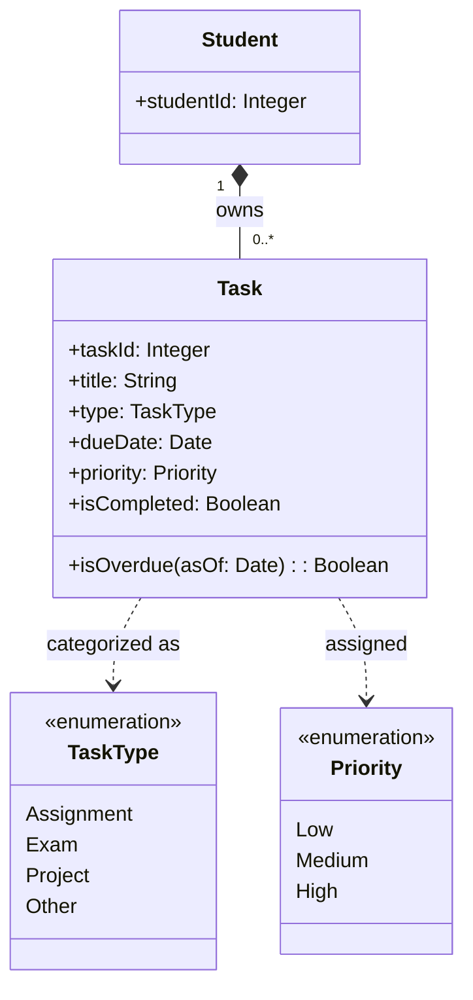

Optimized tool selectionI’ll read the eight user stories and three non-functional requirements first, then draft a domain-focused class diagram and explain the assumptions without changing any files.

Read 

**Draft Domain Model**

**Classes and Relationships**

- **Student** represents the student whose schoolwork is being tracked. The `studentId` provides an identity for associating tasks with that student.
- **Task** represents one piece of schoolwork. Its attributes cover the title, type, due date, priority, and completion status required by the stories. `isOverdue(asOf)` is derived: it is true when the due date is in the past and the task is not completed.
- **TaskType** limits task categories to the supported choices. The requirements name assignments, exams, and projects as examples, so `Other` is included as a reasonable additional option.
- **Priority** captures the three required levels: Low, Medium, and High.
- **Student–Task ownership** is one-to-many: a student can have no tasks or many tasks, and each task belongs to one student. This supports displaying that student’s task list.
- **Task–TaskType** and **Task–Priority** indicate that each task has one category and one priority. These are classifications, not separately managed records.

Pending and completed task lists can be produced by filtering a student’s tasks on `isCompleted`; they do not need their own domain classes. Deletion confirmation is an interaction in the user interface, rather than a persistent domain concept.

**Assumptions**

- A task belongs to exactly one student, and the application may eventually support multiple students. The requirements refer to a student’s list but do not specify accounts or authentication.
- Title, type, due date, and priority are required when a task is saved, since the acceptance criteria describe assigning each of them.
- New tasks start with `isCompleted = false`; completion is represented as a Boolean because the requirements only define pending and completed states.
- “Past due” means the due date is earlier than the current date; the requirements do not specify time-of-day or timezone behavior.
- The three non-functional requirements constrain implementation and testing, rather than requiring extra domain classes: task data must persist across restarts, list retrieval must meet the stated performance target, and the task operations must work in the named browsers.