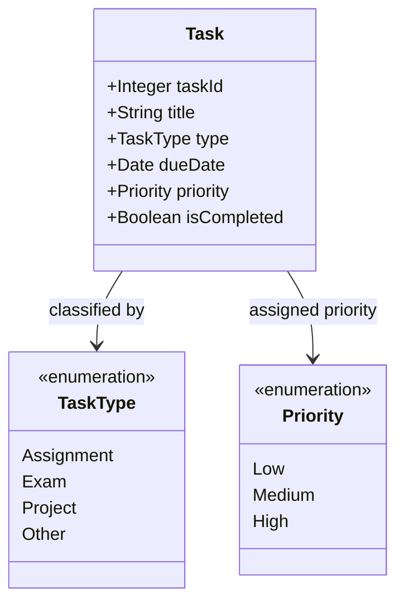

# Student Task Tracker — Domain Model

## IAP M3 — My Domain Model

This model is based on the eight user stories in REQUIREMENTS.md. It uses one main Task entity because the application focuses on managing academic tasks. TaskType and Priority are enumerations, not separate database entities.

## Design Explanation

The Task class stores the information needed to create, view, update, delete, and complete tasks. Pending and completed lists are determined by isCompleted. Overdue tasks are identified by comparing dueDate with the current date when isCompleted is false.

TaskType and Priority restrict the allowed values. They do not need their own database tables.

I did not include a Student class because the current requirements do not specify user accounts, login, or separate student records. If multi-user support is added later, the model can be extended.

This diagram represents the domain structure, not the user interface or the Django implementation.